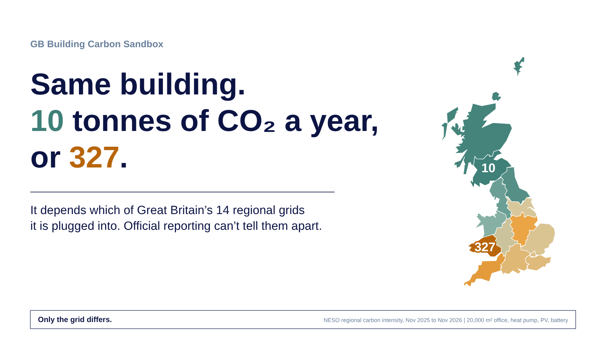

# GB Building Carbon Sandbox

**Live page:** https://reailab-works.github.io/gb-building-carbon-sandbox/

One office building, placed in each of Great Britain's 14 distribution regions. Same fabric, same equipment, same weather model for its region; only the grid it plugs into changes. On the regional hourly grid the building emits from about 10 to 327 tonnes of CO₂ a year. Reported with the official annual factor it is 168–215 tonnes everywhere.

What you can do on the page:

- Enter a postcode to move the building to your region.
- Compare three carbon accounting views: NESO regional hourly intensity, the DESNZ 2026 annual factor, and the Green Book 2026 long-run marginal factor.
- See where a heat pump, a battery and rooftop PV save the most carbon, and whether that still holds under the marginal factor.
- Change the building (type, size, fabric, plant, PV, battery, EV charging, tariffs) and open the full hourly calculation and self-checks.
- Switch between English and Chinese.

Everything runs in the browser from one self-contained `index.html`. No server, no tracking.

## Data

- NESO Carbon Intensity API, regional half-hourly intensity, Nov 2025 – Nov 2026. Supported by National Energy SO Open Data.
- NESO GIS boundaries for GB DNO licence areas; NESO TEC register (19 Nov 2026).
- DESNZ Greenhouse gas reporting conversion factors 2026; DESNZ Green Book supplementary guidance data tables (Oct 2026).
- PVGIS 5.3 © European Union. © OpenStreetMap contributors (ODbL).
- Charts: Apache ECharts 5.5.0 (Apache-2.0).

## Limits

A simplified hourly screening model for comparing regions and measures. It is not a substitute for detailed building simulation and not a basis for design or carbon reporting. The page's "Method and data" section lists every assumption.

Independent project; not affiliated with NESO, DESNZ or CIBSE.
